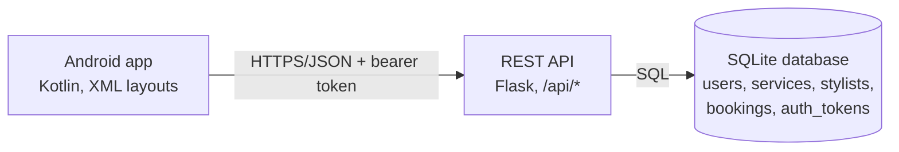

# Spunky's Hairflair – Booking System (Android app + REST API + database)

Team **Coding & Curls** · XISD6329 Work Integrated Learning 3B · Tasks 2 and 3

A native **Kotlin Android app** for booking appointments at Spunky's Hairflair. The app talks to a
**Python (Flask) REST API**, which stores everything in a **relational SQLite database**.



## What is in this repository

```
app/    Android app (Kotlin, Gradle) - screens, API client, unit tests
api/    REST API (Flask) - endpoints, business rules, SQL schema + seed data, tests
docs/   API.md, DATABASE.md, DEPLOY.md (hosting), PLAY_STORE.md (publishing), RELEASE_NOTES.md, PRIVACY_POLICY.md
.github/workflows/android-ci.yml   CI: API tests + Android unit tests + debug APK
```

There is no website source in this repository; the app mirrors the team's website (same services, stylists,
50% deposit, Mon–Sat opening hours, colours).

## Run it

You need: **Python 3.10+**, a recent **Android Studio** (if Gradle sync says the Android Gradle Plugin needs a newer Studio, use *Help ▸ Check for Updates*) and an Android phone with USB debugging
(Task 2 requires the demo on a real phone).

### 1. Start the API

```bash
cd api
python -m venv .venv
.venv\Scripts\activate            # Windows   (macOS/Linux: source .venv/bin/activate)
pip install -r requirements.txt
python -m spunkys_api.init_db     # creates api/data/spunkys.db with schema, catalogue and demo data
flask --app spunkys_api run --host 0.0.0.0 --port 8080
```

Check it: open <http://localhost:8080/api/services> in a browser. Demo login: `lerato.dlamini@example.com` / `Curls2026`.

### 2. Run the app

1. Android Studio → **File ▸ Open** → select this repository's root folder, let Gradle sync.
2. Plug in the phone and run `adb reverse tcp:8080 tcp:8080` (this lets the phone reach the API on your laptop).
3. Press **Run ▶**. Register a new account or use the demo login above.

The API address is set with the `apiBaseUrl` Gradle property (must end with `/`). The default is
`http://localhost:8080/api/`. Other setups:

| Setup | Build with |
|---|---|
| Phone over USB + `adb reverse` | nothing – default |
| Android emulator | `-PapiBaseUrl=http://10.0.2.2:8080/api/` (or put `apiBaseUrl=...` in `gradle.properties`) |
| Phone on the same Wi-Fi | `-PapiBaseUrl=http://<laptop-ip>:8080/api/` (debug builds allow plain HTTP) |
| Hosted API | `-PapiBaseUrl=https://<your-host>/api/` (release builds require HTTPS) |

### Hosting the API (so anyone can use the app)

For other people to use the app, the API must be on the internet. `docs/DEPLOY.md` walks through hosting it on
PythonAnywhere's free plan (HTTPS address, database kept between restarts). Then set
`apiBaseUrl=https://<username>.pythonanywhere.com/api/` and `releaseApiBaseUrl=...` in `gradle.properties` and rebuild.
Environment variables: `SPUNKYS_DB` (database file path), `SPUNKYS_PBKDF2_ITERATIONS`, `SPUNKYS_TOKEN_TTL_DAYS`.

## Tests

| What | Command | Covers |
|---|---|---|
| API + database | `cd api && python -m unittest discover -s tests -v` | registration, login, tokens, profile, password change, booking rules, double-booking, Sunday/past rejection, database constraints, seed data |
| Android | Android Studio: right-click `app/src/test` ▸ *Run Tests* (or `gradle testDebugUnitTest`) | input validation, deposit maths, opening days, API client (login, token header, 401/409/network errors, JSON parsing, caching) |

GitHub Actions (`.github/workflows/android-ci.yml`) runs both test suites and builds the debug APK on every push and pull request.

## Screens → code

| Screen | Class | Data comes from |
|---|---|---|
| Splash, Login, Register | `SplashActivity`, `LoginActivity`, `RegisterActivity` | `POST /auth/login`, `/auth/register` |
| Home, Services | `HomeFragment`, `ServicesFragment` | `GET /services`, `/stylists` |
| Book (4 steps) | `BookFragment` | `GET /availability`, `POST /bookings` |
| My Bookings | `BookingsFragment` | `GET /bookings`, `DELETE /bookings/{id}` |
| Contact, Help | `ContactFragment`, `HelpActivity` | static content |
| Settings (menu ⋮) | `SettingsActivity` | `PUT /me`, `PUT /me/password`, `POST /me/delete`, `POST /auth/logout` |

App code layout: `model/` data classes · `logic/` validators and booking maths (pure Kotlin, unit tested) ·
`data/` API client + repositories + session storage · `ui/` activities, fragments, adapters.
The screens only use the repository interfaces in `data/Repositories.kt`.

## GitHub Actions

`.github/workflows/android-ci.yml` runs on every push and pull request:

1. **API tests** – installs Python, runs the 38 API and database tests.
2. **Android** – installs JDK 17 and the Android SDK, runs the unit tests, builds the debug APK and the release
   bundle (`.aab`), and uploads both as downloadable artifacts. If a step fails, the test reports are uploaded too.

## Publishing to Google Play

The app targets Android 16 (API 36), builds a signed Android App Bundle and has an in-app "Delete my account"
as Google Play requires. Follow `docs/PLAY_STORE.md`; the privacy policy template is in `docs/PRIVACY_POLICY.md`.

## Release notes

See [`docs/RELEASE_NOTES.md`](docs/RELEASE_NOTES.md) for everything that changed since the prototype.

## Task 2 checklist

| Requirement | Status |
|---|---|
| Android app code, GUI, input controls, program modules | Done |
| Register / sign in with hashed passwords | Done – server-side salted PBKDF2-HMAC-SHA256, bearer-token sessions |
| User can change their settings | Done – Settings screen → `PUT /me`, `/me/password`, delete account → `POST /me/delete` |
| Help / user support | Done – Help screen |
| Invalid input handled without crashing | Done – validation in the app **and** the API; network errors shown as messages |
| REST API | Done – `api/`, documented in `docs/API.md`, tested |
| App integrated with the API | Done – `data/ApiClient.kt`, `data/ApiRepositories.kt` |
| Database design | Done – `api/db/schema.sql`, `docs/DATABASE.md` (5 tables, FKs, constraints, 10+ sample rows) |
| Automated tests + GitHub Actions | Done |
| Ready for Google Play (task 3) | Done – API 36, signed bundle build, privacy policy, store checklist |
| Single sign-on (SSO) | Not implemented (needs an external identity provider) |
| Azure DevOps updates, demo video with voice-over | Team |

## Demo accounts

Ten sample customers are created by the seed (all password `Curls2026`), e.g. `lerato.dlamini@example.com`,
`thando.mokoena@example.com`. They are made-up data – delete them before any real deployment.
# Spunky's Hairflair – Booking Website

Team **Coding & Curls** · XISD5319 Work Integrated Learning 3A

A booking website for Spunky's Hairflair (Mandalay, Mitchell's Plain). Customers register / log in, choose a
service and stylist, pick an available date and time, see the 50% deposit and manage their appointments.
Built with HTML5, CSS3 and JavaScript (ES6) in Visual Studio Code. The Android app in the `android` folder mirrors it.

## Pages

| File | Page | What it does |
|---|---|---|
| `index.html` | Home | Hero banner, service preview, meet the stylists, login prompt |
| `book.html` | Book Now | 4 steps: service → stylist → date & time → summary with 50% deposit |
| `bookings.html` | My Bookings | View and cancel your appointments |
| `services.html` | Services | Full catalogue with price, duration and a Book button |
| `contact.html` | Contact | Address, phone, email, social media |
| `help.html` | Help | FAQ / user support |
| `settings.html` | Settings | Change name, phone and password; log out |

## Stylists

Asenathi Valashiya (Braiding Specialist), Siphokazi Nofemele (Cuts & Relaxers),
Rethabile Minnaar (Weaves & Extensions), **Luna Summerton (Barber)**.

## Folder structure

```
index.html  book.html  bookings.html  services.html  contact.html  help.html  settings.html
css/styles.css
js/data.js        services, stylists, time slots, pricing, date + validation logic (unit tested)
js/common.js      navbar, footer, login/register modal, account storage, password hashing, toast
js/book.js        booking flow          js/bookings.js   my bookings
js/services.js    services + home       js/settings.js   settings page
tests/            automated tests (Node built-in test runner)
.github/workflows/website-ci.yml   GitHub Actions: syntax check + tests on every push
```

## Run it (VS Code)

1. Install the **Live Server** extension, right-click `index.html` → *Open with Live Server*
   (password hashing needs `http://localhost`/`127.0.0.1`, not a plain file).
2. Sign up on the Register tab, then book.

## Run the tests

```
npm test
```
(needs Node 18+). The same tests run automatically on GitHub via **Actions → Website CI**.

## Notes

- Data is stored in the browser's `localStorage`; the database/API layer is handled separately by the team.
- Passwords are stored as a salted PBKDF2-SHA256 hash (Web Crypto), never in plain text.
- The salon is open Mon–Sat, so Sundays can't be booked; past times are hidden; a stylist's already-booked
  times are disabled to prevent double-bookings.
