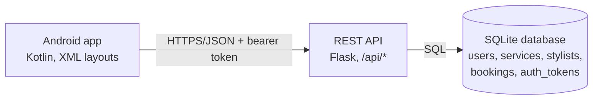

# Spunky's Hairflair – Booking System (Android app + REST API + database)

Team **Coding & Curls** · XISD6329 Work Integrated Learning 3B · Task 2

A native **Kotlin Android app** for booking appointments at Spunky's Hairflair. The app talks to a
**Python (Flask) REST API**, which stores everything in a **relational SQLite database**.



## What is in this repository

```
app/    Android app (Kotlin, Gradle) - screens, API client, unit tests
api/    REST API (Flask) - endpoints, business rules, SQL schema + seed data, tests
docs/   API.md (endpoint reference), DATABASE.md (ERD + table design)
.github/workflows/android-ci.yml   CI: API tests + Android unit tests + debug APK
```

There is no website source in this repository; the app mirrors the team's website (same services, stylists,
50% deposit, Mon–Sat opening hours, colours).

## Run it

You need: **Python 3.10+**, **Android Studio** (JDK 17 is bundled) and an Android phone with USB debugging
(Task 2 requires the demo on a real phone).

### 1. Start the API

```bash
cd api
python -m venv .venv
.venv\Scripts\activate            # Windows   (macOS/Linux: source .venv/bin/activate)
pip install -r requirements.txt
python -m spunkys_api.init_db     # creates api/data/spunkys.db with schema, catalogue and demo data
flask --app spunkys_api run --host 0.0.0.0 --port 8080
```

Check it: open <http://localhost:8080/api/services> in a browser. Demo login: `lerato.dlamini@example.com` / `Curls2026`.

### 2. Run the app

1. Android Studio → **File ▸ Open** → select this repository's root folder, let Gradle sync.
2. Plug in the phone and run `adb reverse tcp:8080 tcp:8080` (this lets the phone reach the API on your laptop).
3. Press **Run ▶**. Register a new account or use the demo login above.

The API address is set with the `apiBaseUrl` Gradle property (must end with `/`). The default is
`http://localhost:8080/api/`. Other setups:

| Setup | Build with |
|---|---|
| Phone over USB + `adb reverse` | nothing – default |
| Android emulator | `-PapiBaseUrl=http://10.0.2.2:8080/api/` (or put `apiBaseUrl=...` in `gradle.properties`) |
| Phone on the same Wi-Fi | `-PapiBaseUrl=http://<laptop-ip>:8080/api/` (debug builds allow plain HTTP) |
| Hosted API | `-PapiBaseUrl=https://<your-host>/api/` (release builds require HTTPS) |

### Hosting the API (optional)

`api/Procfile` and `requirements.txt` work on Render, Railway or Heroku-style hosts
(`gunicorn "spunkys_api:create_app()"`). On first start the API creates the database and demo data by itself.
Free tiers often reset the disk on restart, which simply re-creates the demo data.
Environment variables: `SPUNKYS_DB` (database file path), `SPUNKYS_PBKDF2_ITERATIONS`, `SPUNKYS_TOKEN_TTL_DAYS`.

## Tests

| What | Command | Covers |
|---|---|---|
| API + database | `cd api && python -m unittest discover -s tests -v` | registration, login, tokens, profile, password change, booking rules, double-booking, Sunday/past rejection, database constraints, seed data |
| Android | Android Studio: right-click `app/src/test` ▸ *Run Tests* (or `gradle testDebugUnitTest`) | input validation, deposit maths, opening days, API client (login, token header, 401/409/network errors, JSON parsing, caching) |

GitHub Actions (`.github/workflows/android-ci.yml`) runs both test suites and builds the debug APK on every push and pull request.

## Screens → code

| Screen | Class | Data comes from |
|---|---|---|
| Splash, Login, Register | `SplashActivity`, `LoginActivity`, `RegisterActivity` | `POST /auth/login`, `/auth/register` |
| Home, Services | `HomeFragment`, `ServicesFragment` | `GET /services`, `/stylists` |
| Book (4 steps) | `BookFragment` | `GET /availability`, `POST /bookings` |
| My Bookings | `BookingsFragment` | `GET /bookings`, `DELETE /bookings/{id}` |
| Contact, Help | `ContactFragment`, `HelpActivity` | static content |
| Settings (menu ⋮) | `SettingsActivity` | `PUT /me`, `PUT /me/password`, `POST /auth/logout` |

App code layout: `model/` data classes · `logic/` validators and booking maths (pure Kotlin, unit tested) ·
`data/` API client + repositories + session storage · `ui/` activities, fragments, adapters.
The screens only use the repository interfaces in `data/Repositories.kt`.

## Task 2 checklist

| Requirement | Status |
|---|---|
| Android app code, GUI, input controls, program modules | Done |
| Register / sign in with hashed passwords | Done – server-side salted PBKDF2-HMAC-SHA256, bearer-token sessions |
| User can change their settings | Done – Settings screen → `PUT /me`, `/me/password` |
| Help / user support | Done – Help screen |
| Invalid input handled without crashing | Done – validation in the app **and** the API; network errors shown as messages |
| REST API | Done – `api/`, documented in `docs/API.md`, tested |
| App integrated with the API | Done – `data/ApiClient.kt`, `data/ApiRepositories.kt` |
| Database design | Done – `api/db/schema.sql`, `docs/DATABASE.md` (5 tables, FKs, constraints, 10+ sample rows) |
| Automated tests + GitHub Actions | Done |
| Single sign-on (SSO) | Not implemented (needs an external identity provider) |
| Azure DevOps updates, demo video with voice-over | Team |

## Demo accounts

Ten sample customers are created by the seed (all password `Curls2026`), e.g. `lerato.dlamini@example.com`,
`thando.mokoena@example.com`. They are made-up data – delete them before any real deployment.
