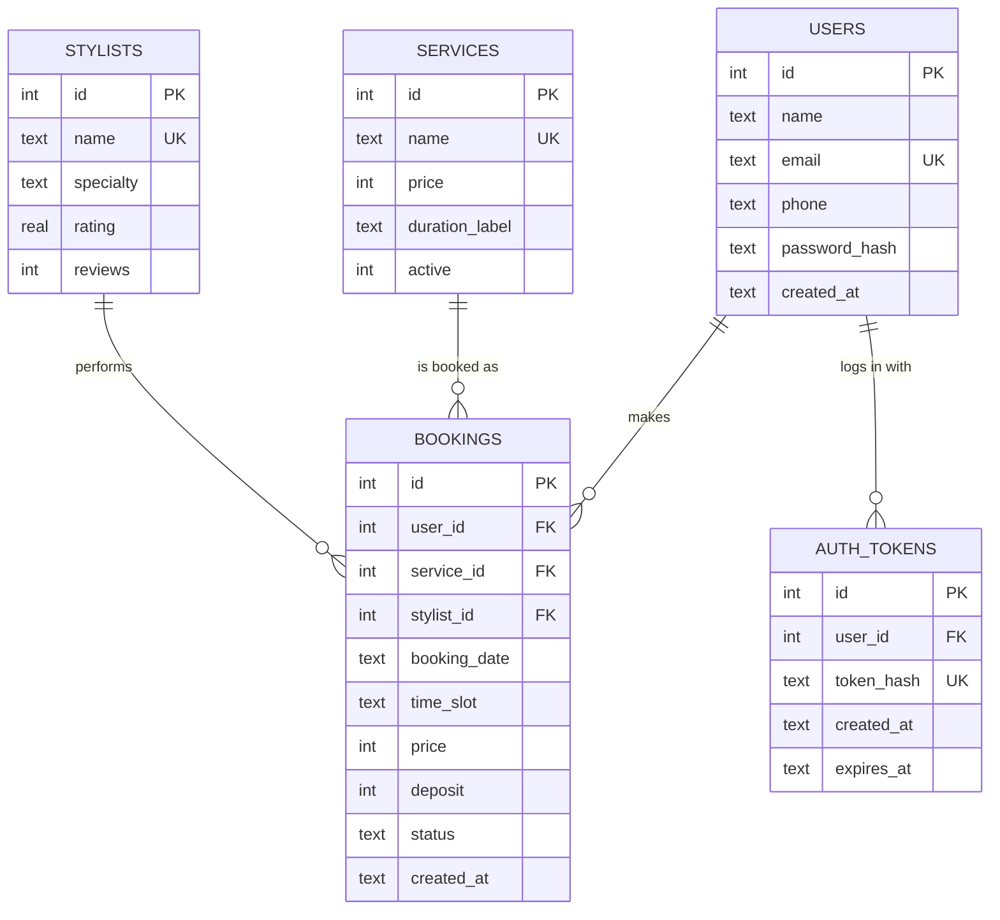

# Database design

DBMS: **SQLite 3** (file `api/data/spunkys.db`, created automatically). DDL: [`api/db/schema.sql`](../api/db/schema.sql).
Catalogue data: [`api/db/seed_catalog.sql`](../api/db/seed_catalog.sql). Demo customers/bookings: [`api/spunkys_api/seed.py`](../api/spunkys_api/seed.py).
Rebuild at any time: `cd api && python -m spunkys_api.init_db --reset`.

## Entity-relationship diagram

(PNG for the report: [`erd.png`](erd.png))

## Tables

| Table | Purpose | Key constraints |
|---|---|---|
| `users` | Customer accounts | `email` UNIQUE (case-insensitive); name length CHECK; password stored only as salted PBKDF2 hash |
| `services` | Service catalogue | `name` UNIQUE; `price > 0`; `active` is 0/1 |
| `stylists` | Staff | `name` UNIQUE; `rating` between 0 and 5 |
| `bookings` | Appointments | FKs to users (CASCADE), services and stylists (RESTRICT); `status` in (`confirmed`,`cancelled`); `deposit <= price`; date format CHECK |
| `auth_tokens` | Login sessions | FK to users (CASCADE); only the SHA-256 of the token is stored; `expires_at` |

Relationships: one user has many bookings; one service and one stylist can appear in many bookings (all one-to-many).
The schema is in third normal form: names of services/stylists live once and bookings reference them by id.
`price` and `deposit` are deliberately copied onto the booking so later price changes do not rewrite history.

## Rules enforced by the database itself

* **No double-booking:** `CREATE UNIQUE INDEX ux_bookings_active_slot ON bookings (stylist_id, booking_date, time_slot) WHERE status <> 'cancelled'`.
* **Referential integrity:** `PRAGMA foreign_keys = ON` on every connection.
* **Soft delete:** cancelling sets `status = 'cancelled'` (history is kept and the slot is freed by the partial index).
* **Data quality:** CHECK constraints on price, deposit, rating, status and date format.

## Sample data

| Table | Rows |
|---|---|
| `users` | 10 demo customers (password `Curls2026`) |
| `services` | 10 (the 6 website services + 4 extra samples) |
| `stylists` | 4 (the team) |
| `bookings` | 12 (11 confirmed, 1 cancelled) |

## Moving to a server DBMS

The SQL is standard apart from `AUTOINCREMENT`, `strftime` defaults and the `GLOB` date check. To use PostgreSQL/MySQL,
swap those for `SERIAL`/`AUTO_INCREMENT`, `CURRENT_TIMESTAMP` and a `CHECK` with a regex, and replace the `sqlite3`
calls in `spunkys_api/db.py`/`routes.py` with your driver. The API contract does not change.
